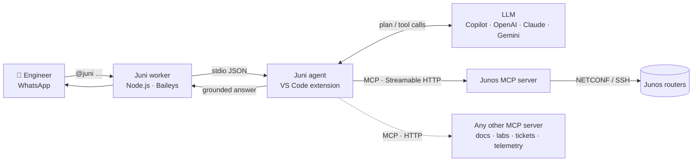
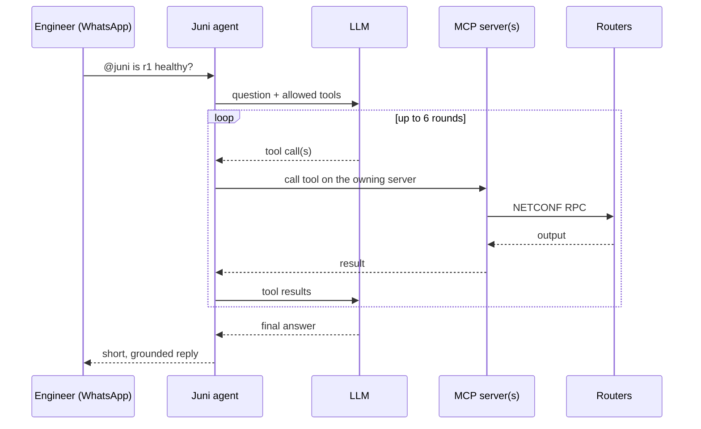

<div align="center">

# 📱 Juni

### Your network, one text away.

**An agentic AI assistant that connects live network knowledge to the chat your team already uses.**
Ask your Juniper Junos routers anything in plain English — from WhatsApp.


</div>

```text
You  (WhatsApp):  @juni is r1 healthy and did anything change today?

Juni (WhatsApp):  r1 looks healthy:
                  - No active system alarms
                  - All BGP peers Established
                  - Core interfaces up
                  Changes today: 1 commit (description update)
```

> No laptop. No VPN. No CLI. Every answer comes from the live devices.

---

## Contents

- [Why Juni](#-why-juni)
- [What it does](#-what-it-does)
- [How it works](#-how-it-works)
- [Quick start](#-quick-start)
- [Talking to Juni](#-talking-to-juni)
- [Configuration](#%EF%B8%8F-configuration)
- [Adding more knowledge sources](#-adding-more-knowledge-sources)
- [Safety & trust](#-safety--trust)
- [Troubleshooting](#-troubleshooting)
- [Project layout](#-project-layout)
- [Tech stack](#-tech-stack)
- [Roadmap](#-roadmap)
- [References](#-references)
- [License](#-license)

---

## 💡 Why Juni

Answering even a simple question about a network — *"is r1 OK?"*, *"what changed
before this alarm?"* — usually means finding a laptop, connecting to VPN, SSH-ing
into each device and remembering the exact Junos command. The knowledge you need
is spread across live state, running configuration, change history and inventory,
and it sits behind the CLI and a few experts.

Meanwhile, the team is already coordinating on WhatsApp — by pasting screenshots.

**Juni closes that gap.** It's an AI agent you message like a colleague. It works out
which knowledge sources and tools it needs, runs them against live devices,
connects the results, and answers in seconds — right in the chat.

---

## ✨ What it does

| | |
| --- | --- |
| 🗣️ **Plain-English questions** | Ask naturally; Juni picks the right tools and arguments. |
| 🔗 **Multi-source answers** | One message can combine inventory, device facts, operational state, configuration and config diffs. |
| 🔁 **Multi-step reasoning** | Chains up to **6 rounds** of tool calls per question and correlates the results. |
| ⚡ **Fleet-wide in parallel** | Batch commands fan out to every router at once — not N sequential SSH sessions. |
| 🔌 **Any MCP source, by URL** | Every knowledge source is an [MCP](https://modelcontextprotocol.io) server. Add one in config — no code. |
| 💸 **Zero new AI spend** | Uses your **GitHub Copilot** models through the VS Code Language Model API — no API keys. OpenAI, Anthropic Claude and Google Gemini are one setting away. |
| 🎯 **Grounded** | Answers only from tool output; never invents devices or results. Ask for *raw output* to get the verbatim device response. |
| 👥 **Team-ready** | Allow-list colleagues' numbers so a whole on-call team shares one assistant. |
| 🏠 **Local-first** | Runs on your machine, beside the network. Credentials never leave it. |

**Tools available today** (via the [Junos MCP server](https://github.com/Juniper/junos-mcp-server)):
`get_router_list` · `gather_device_facts` · `execute_junos_command` ·
`execute_junos_command_batch` · `get_junos_config` · `junos_config_diff` ·
`load_and_commit_config` · `render_and_apply_j2_template` · `add_device` · and more.

---

## 🧠 How it works



| Component | Role |
| --- | --- |
| **WhatsApp worker** (`worker/whatsapp-worker.mjs`) | Links to WhatsApp as a linked device (QR code), filters messages by trigger and allow-list, and exchanges JSON with the extension over stdio. |
| **Juni agent** (`src/`) | A VS Code extension. Discovers tools from every configured MCP server, applies policy, runs the LLM tool-calling loop and formats replies for a phone screen. |
| **LLM planner** | GitHub Copilot via the VS Code Language Model API (default), or OpenAI / Anthropic / Gemini. |
| **MCP servers** | Knowledge sources. The [Junos MCP server](https://github.com/Juniper/junos-mcp-server) reaches routers over NETCONF/SSH with Junos PyEZ. |

> **Why a VS Code extension?** Copilot models are only reachable through VS Code's
> Language Model API, which runs inside an extension. That's the supported,
> no-API-key way to reuse an existing Copilot subscription.

### The agent loop



1. **Discover** — on start, load tools from every MCP server and merge them into one catalogue.
2. **Plan** — the LLM chooses which tools to call and with which arguments.
3. **Act** — Juni executes each call on the server that owns the tool.
4. **Ground** — results go back to the LLM; repeat up to 6 rounds; no invented facts.
5. **Reply** — a short, plain-text answer, sent back to the same chat.

---

## 🚀 Quick start

### Prerequisites

| Requirement | Check |
| --- | --- |
| macOS or Linux | — |
| [Node.js](https://nodejs.org) 18+ | `node -v` |
| [Python](https://python.org) 3.10+ | `python3 --version` |
| [VS Code](https://code.visualstudio.com) + **GitHub Copilot Chat** (signed in) | Copilot icon in the status bar |
| SSH/NETCONF reachability to your Junos devices | `nc -z <router-ip> 22` |

### 1. Clone Juni and the Junos MCP server side by side

```bash
mkdir juni-workspace && cd juni-workspace
git clone https://github.com/venkata-sai-vishwanath-hpe/Juni.git
git clone https://github.com/Juniper/junos-mcp-server.git
```

### 2. Set up and start the Junos MCP server

```bash
cd junos-mcp-server
python3 -m venv .venv
./.venv/bin/pip install -r requirements.txt
./.venv/bin/pip install "mcp[cli]>=1.12.2,<2.0"   # the server targets the mcp 1.x API
```

Describe your routers in `devices.json` (see `devices-template.json` for SSH-key options):

```json
{
  "r1": {
    "ip": "192.0.2.10",
    "port": 22,
    "username": "admin",
    "auth": { "type": "password", "password": "<password>" }
  }
}
```

Start the server and **keep this terminal open** — you'll see every tool call and
NETCONF session here:

```bash
./.venv/bin/python jmcp.py -t streamable-http -H 127.0.0.1 -p 30030 \
  -f devices.json --allow-unauthenticated-http
```

Ready when you see `Uvicorn running on http://127.0.0.1:30030`.

> `--allow-unauthenticated-http` is for local development and only binds to
> loopback. For anything else, enable token auth on the server and pass the token
> in `headers` (see [Configuration](#%EF%B8%8F-configuration)).

### 3. Build and install Juni

```bash
cd ../Juni
npm install
npm run build
npx --yes @vscode/vsce package --allow-missing-repository --skip-license -o juni.vsix
code --install-extension juni.vsix --force
```

Reload VS Code: `Cmd/Ctrl+Shift+P` → **Developer: Reload Window**.

<details>
<summary>Prefer to run from source (development)?</summary>

```bash
cd Juni
npm run setup      # checks prerequisites, installs deps, builds
code .             # then press F5 → "Run Junos WhatsApp Bridge"
```

A second **[Extension Development Host]** window opens with Juni loaded.
</details>

### 4. Link WhatsApp

1. `Cmd/Ctrl+Shift+P` → **Junos WhatsApp: Start Bridge**
2. A QR code panel opens.
3. On your phone: **WhatsApp → Settings → Linked Devices → Link a Device** → scan.
4. Wait for **"WhatsApp is linked and ready."**

### 5. Say hi

In your own **"Message yourself"** chat:

```text
@juni what routers do I have?
```

🎉 That's it. A more detailed walkthrough is in [SETUP.md](SETUP.md).

---

## 💬 Talking to Juni

- **From your own number** — start the message with **`@juni`**. The prefix keeps
  Juni out of your normal conversations.
- **From a colleague's number** — add it to `whatsapp.allowedNumbers`
  (country code + digits, no `+`). They message your linked account directly; no
  prefix needed.
- **Want the exact device output?** Add *"raw output"* to your question.

**Things to try**

```text
@juni hey, what can you do?
@juni what routers do I have?
@juni gather facts for r1
@juni health-check all routers: alarms, interfaces and BGP
@juni show me the current config on r1
@juni what changed in the config on r1?
@juni show system uptime on r2, raw output
```

---

## ⚙️ Configuration

Everything lives in **`bridge.config.json`**. Open it from the Command Palette with
**Junos WhatsApp: Open Config File**, then **Stop Bridge → Start Bridge** to apply.
A fully commented reference is in [`bridge.config.example.jsonc`](bridge.config.example.jsonc).

```jsonc
{
  "ai": {
    "provider": "copilot",            // copilot | openai | anthropic | gemini
    "model": "claude-sonnet-4.5",     // Copilot model family, or the provider's model id
    "apiKeys": { "openai": "", "anthropic": "", "gemini": "" }  // only for non-Copilot providers
  },
  "systemPrompt": "",                 // "" = built-in Juni prompt
  "mcp": {
    "enabledTools": "readonly",       // "readonly" = safe tools only | "all" = everything
    "readOnlyToolNames": [ "get_router_list", "get_junos_config", "junos_config_diff", "gather_device_facts" ],
    "servers": [
      { "name": "junos", "url": "http://localhost:30030/mcp", "headers": {} }
    ]
  },
  "whatsapp": {
    "triggerPrefix": "@juni",
    "allowedNumbers": []              // e.g. ["919876543210"]
  }
}
```

| Key | What it does |
| --- | --- |
| `ai.provider` / `ai.model` | Which LLM answers. Run **Junos WhatsApp: Select Copilot Model** to pick from the Copilot models you actually have. |
| `systemPrompt` | Override Juni's built-in prompt. |
| `mcp.enabledTools` | `readonly` exposes only tools the server marks read-only (or that are listed in `readOnlyToolNames`). `all` also allows configuration changes. |
| `mcp.servers` | One or more MCP servers. Tools are merged; each call is routed to the server that owns the tool. |
| `whatsapp.triggerPrefix` | Prefix required on your own messages. |
| `whatsapp.allowedNumbers` | Other numbers allowed to talk to Juni. |

> ⚠️ The sample `bridge.config.json` in this repo uses `"enabledTools": "all"` for
> demos. Switch it to `"readonly"` unless you want Juni to be able to change device
> configuration.

**VS Code settings** (search *"Junos WhatsApp"*):

| Setting | Default | Description |
| --- | --- | --- |
| `junosWhatsapp.configPath` | *(auto)* | Absolute path to `bridge.config.json`. If empty: workspace file, else the one shipped with the extension. |
| `junosWhatsapp.resetAuthOnStart` | `true` | Clear the WhatsApp session on every start (fresh QR each time). Set `false` to stay linked between restarts. |

**Commands** (`Cmd/Ctrl+Shift+P` → *Junos WhatsApp*):

| Command | Action |
| --- | --- |
| Start Bridge | Connect MCP servers + WhatsApp |
| Stop Bridge | Shut everything down |
| Show Login QR | Re-open the QR panel |
| Log Out / Unlink | Unlink this WhatsApp device |
| Select Copilot Model | Choose the Copilot model Juni uses |
| Open Config File | Edit `bridge.config.json` |

---

## 🔌 Adding more knowledge sources

Juni is source-agnostic: anything that speaks MCP over HTTP becomes part of its
toolset. Add an entry to `mcp.servers` and restart the bridge:

```jsonc
"servers": [
  { "name": "junos", "url": "http://localhost:30030/mcp", "headers": {} },
  { "name": "docs",  "url": "https://mcp.example.internal/mcp",
    "headers": { "Authorization": "Bearer <token>" } }
]
```

Juni discovers the new tools at start-up, and the LLM starts using them whenever a
question needs them — no code changes.

---

## 🔒 Safety & trust

- **Read-only mode** — `enabledTools: "readonly"` hides every tool that can change state.
- **Server-side guardrails** — the Junos MCP server rejects commands and config lines
  matching regex blocklists in `block.cmd` / `block.cfg` (e.g. reboot, zeroize,
  password changes), and fails closed if those files are missing.
- **Who can talk to it** — a trigger prefix for your own messages and an explicit
  allow-list for anyone else.
- **Grounded answers** — the agent is instructed never to invent device names,
  addresses or results.
- **Local session** — the WhatsApp session is stored in VS Code's extension storage
  (`wa-auth/`), never in this repo. Anyone with that folder can act as your linked
  device; use **Log Out / Unlink** to revoke.
- **Secrets** — keep router credentials (`devices.json`) and API keys out of version control.
- **Data flow** — questions and tool output are sent to the LLM provider you choose.
- **Unofficial WhatsApp client** — Juni uses [Baileys](https://github.com/WhiskeySockets/Baileys),
  an unofficial WhatsApp Web library. Automated use carries a risk of rate limiting
  or bans; use a number you can afford to lose and keep volume low.

---

## 🆘 Troubleshooting

Start with the log: **View → Output → "Junos WhatsApp Bridge"**. It shows MCP
connection, QR, incoming messages, tool calls and replies.

| Symptom | Fix |
| --- | --- |
| `fetch failed: connect ECONNREFUSED 127.0.0.1:30030` | The MCP server isn't running. Start it (Quick start step 2), then **Start Bridge** again. |
| `ImportError: cannot import name 'ServerSessionT'` | `mcp` 2.x is installed. Run `pip install "mcp[cli]>=1.12.2,<2.0"` in the server's venv. |
| `address already in use` on port 30030 | The server is already running. To restart: `kill $(lsof -nP -iTCP:30030 -sTCP:LISTEN -t)`. |
| "No Copilot chat models are available" | Install **GitHub Copilot Chat**, sign in, then **Select Copilot Model**. |
| F5 does nothing / dev host window closes | Install the packaged VSIX instead (Quick start step 3). |
| No reply to a message | Make sure it starts with `@juni`; look for a `Saw message` line in the log. |
| Link a different phone | **Log Out / Unlink**, then **Start Bridge** for a fresh QR; remove the old entry under WhatsApp → Linked Devices. |
| `Bad MAC` / `MessageCounterError` | Session out of sync — see [TROUBLESHOOTING.md](TROUBLESHOOTING.md). |

More detail: [SETUP.md](SETUP.md) · [TROUBLESHOOTING.md](TROUBLESHOOTING.md)

---

## 🗂️ Project layout

```text
Juni/
├── src/
│   ├── extension.ts       # VS Code entry: commands, bridge lifecycle, QR panel, worker I/O
│   ├── agent.ts           # Agent loop: tool policy, LLM tool calling (≤ 6 rounds), grounding
│   ├── llm.ts             # Providers: GitHub Copilot, OpenAI, Anthropic, Gemini
│   ├── mcpClient.ts       # MCP over Streamable HTTP (SSE fallback); merges + routes tools
│   └── config.ts          # bridge.config.json loading, defaults, Juni system prompt
├── worker/
│   └── whatsapp-worker.mjs  # Baileys WhatsApp client (QR login, trigger, allow-list)
├── bridge.config.json          # Runtime configuration
├── bridge.config.example.jsonc # Fully commented reference
├── setup.sh                    # One-command prerequisite check + build
├── SETUP.md                    # Detailed setup guide
└── TROUBLESHOOTING.md          # WhatsApp session troubleshooting
```

---

## 🧰 Tech stack

| Layer | Technology |
| --- | --- |
| LLMs | GitHub Copilot via VS Code Language Model API (default Claude Sonnet 4.5) · OpenAI · Anthropic Claude · Google Gemini |
| Agent | TypeScript VS Code extension · custom tool-calling loop · esbuild · VSIX |
| Protocol | Model Context Protocol — TypeScript SDK client, Streamable HTTP |
| Knowledge source | Juniper junos-mcp-server (Python) · Junos PyEZ · NETCONF over SSH |
| Messaging | WhatsApp multi-device via Baileys (Node.js) · QR pairing |

---

## 🗺️ Roadmap

- **Pilot** — internal labs and an on-call team; measure time-to-answer and escalations avoided.
- **Harden** — headless server deployment, official WhatsApp Business Platform,
  per-user roles and audit log; Microsoft Teams and Slack channels.
- **Orchestrate deeper** — incident memory for recurring-incident prevention, a
  topology/dependency graph from LLDP and BGP neighbours, proactive alerts pushed to
  chat with a suggested fix, and connectors for more platforms.

---

## 📚 References

- [Model Context Protocol](https://modelcontextprotocol.io) · [MCP TypeScript SDK](https://github.com/modelcontextprotocol/typescript-sdk)
- [Juniper junos-mcp-server](https://github.com/Juniper/junos-mcp-server) · [Junos PyEZ](https://github.com/Juniper/py-junos-eznc)
- [VS Code Language Model API](https://code.visualstudio.com/api/extension-guides/language-model)
- [Baileys — WhatsApp Web API](https://github.com/WhiskeySockets/Baileys)
- [RFC 6241 — NETCONF](https://datatracker.ietf.org/doc/html/rfc6241)

---

## 📄 License

[MIT](LICENSE)

> Juni is a hackathon project and is not an official Juniper Networks, HPE or
> WhatsApp product. WhatsApp is a trademark of Meta Platforms, Inc.
